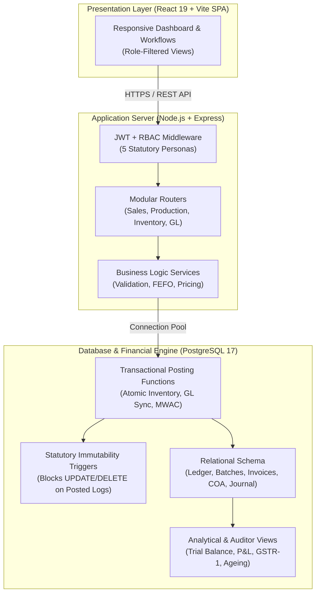
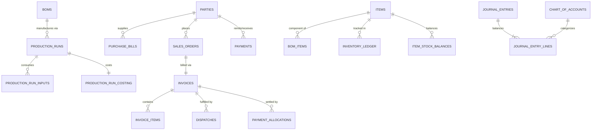

# Order-to-Audit ERP — Technical Design & Architecture Note

> **Evaluation Submission**: Food-Manufacturing ERP System  
> **Target Evaluation**: NIT Tiruchirappalli Internship Technical Assessment  
> **Authorship**: Engineering Lead / Full-Stack System Architect  
> **Tech Stack**: Node.js (ES Modules, Express), PostgreSQL 17, React 19 (Vite), Docker  

---

## 1. Executive Summary & Architectural Overview

Order-to-Audit is a food-manufacturing Enterprise Resource Planning (ERP) platform built around **three non-negotiable principles**:
1. **Mathematical Financial Integrity**: Full double-entry general ledger with automatic statutory tax segregation (CGST/SGST/IGST) and zero unrecorded financial movement.
2. **Physical Inventory Determinism**: An immutable, append-only inventory ledger where stock levels are derived from chronological movements and valued via database-enforced Moving Weighted Average Cost (MWAC).
3. **Auditability & Traceability**: Bidirectional batch tracing from raw agricultural material receipts to final consumer retail invoices, protected by row-level immutable triggers.



---

## 2. Core Data Model & Entity Relationship Architecture

The data model enforces relational integrity across five operational domains:



### Table Domain Mapping
- **Master Data**: `items`, `units_of_measure`, `boms`, `bom_items`, `parties`, `warehouses`, `users`.
- **Inbound Supply**: `purchase_bills`, `purchase_bill_items`, `supplier_payments`, `supplier_payment_allocations`.
- **Production & Costing**: `production_runs`, `production_run_inputs`, `production_run_overheads`, `production_run_costing`.
- **Outbound & Invoicing**: `sales_orders`, `sales_order_items`, `invoices`, `invoice_items`, `dispatches`, `dispatch_items`.
- **Inventory Engine**: `inventory_ledger`, `item_stock_balances`, `item_batches`, `stock_adjustments`, `warehouse_transfers`.
- **General Ledger**: `chart_of_accounts`, `journal_entries`, `journal_entry_lines`, `audit_logs`.

---

## 3. Stock Ledger Mechanics & Immutability Guarantees

### Append-Only Invariant
The inventory system strictly forbids in-place modification of historical stock records. Every stock alteration creates a new row in `inventory_ledger`.

```sql
-- Database Trigger Enforcing Append-Only Immutability
CREATE OR REPLACE FUNCTION fn_prevent_inventory_ledger_tampering()
RETURNS TRIGGER AS $$
BEGIN
    RAISE EXCEPTION 'CRITICAL AUDIT VIOLATION: inventory_ledger is append-only. UPDATE and DELETE operations are strictly prohibited.'
        USING ERRCODE = '55000';
END;
$$ LANGUAGE plpgsql;

CREATE TRIGGER trg_protect_inventory_ledger
    BEFORE UPDATE OR DELETE ON inventory_ledger
    FOR EACH ROW EXECUTE FUNCTION fn_prevent_inventory_ledger_tampering();
```

### Stock Balance Synchronization
`item_stock_balances` serves as an ACID-safe cache of current inventory levels, protected by check constraints (`CHECK (current_base_qty >= 0.0000)`). Any attempt to dispatch or consume more stock than is physically available triggers an instantaneous PostgreSQL check violation, making race conditions and negative inventory physically impossible.

---

## 4. Moving Weighted Average Cost (MWAC) & BOM Mass Balance Formulas

### Moving Weighted Average Cost Formula
Upon every inbound inventory receipt (Purchases, Positive Cycle Adjustments, or Finished Goods Yield), the unit rate is recalculated:

$$\text{New MWAC} = \frac{(\text{Current Qty} \times \text{Current MWAC}) + (\text{Received Qty} \times \text{Purchase Unit Rate})}{\text{Current Qty} + \text{Received Qty}}$$

#### Benchmark Validation Proof (Raw Flour):
- Opening Flour: $100\text{ kg} \times ₹42.00 = ₹4,200.00$
- Inbound Purchase: $60\text{ kg} \times ₹45.00 = ₹2,700.00$
- Total Value: $₹4,200.00 + ₹2,700.00 = ₹6,900.00$
- Total Physical Quantity: $100\text{ kg} + 60\text{ kg} = 160\text{ kg}$
- Recalculated MWAC: $\frac{₹6,900.00}{160\text{ kg}} = \mathbf{₹43.1250/\text{kg}}$

### Production Material Issue Rate Invariant
When materials are issued to production, they are issued **at their current Moving WAC**. Material consumption decrements physical stock and total valuation proportionally, leaving the **unit rate unchanged**:
- Flour consumed: $40\text{ kg} \times ₹43.1250 = ₹1,725.00$
- Closing Flour: $160 - 40 = 120\text{ kg} \times ₹43.1250 = \mathbf{₹5,175.00}$ (Unit rate remains exactly ₹43.1250/kg).

---

## 5. Production Yield & Material Consumption Variance Formulas

### Production Cost Rollup
Total manufacturing cost absorbs direct materials, primary packaging, and factory overheads:

$$\text{Total Production Cost} = \sum \text{Raw Material Costs} + \sum \text{Packaging Costs} + \sum \text{Direct Overheads}$$

$$\text{Finished Good Unit Cost} = \frac{\text{Total Production Cost}}{\text{Actual Good Output Quantity}}$$

#### Benchmark Costing Proof:
- Raw Flour ($40\text{ kg} \times ₹43.125$): $₹1,725.00$
- Cooking Oil ($10.5\text{ L} \times ₹140.00$): $₹1,470.00$
- Spice Mix ($1.2\text{ kg} \times ₹200.00$): $₹240.00$
- Pouches ($188\text{ good} + 6\text{ damaged} = 194\text{ pcs} \times ₹2.50$): $₹485.00$
- Cartons ($9\text{ cartons} \times ₹15.00$): $₹135.00$
- **Total Direct Materials & Packaging**: $\mathbf{₹4,055.00}$
- Factory Overheads (Labour ₹1,200 + Power/Gas ₹600): $\mathbf{₹1,800.00}$
- **Gross Batch Production Cost**: $\mathbf{₹5,855.00}$
- Actual Good Output: $188\text{ packets}$
- **Unit Cost Produced**: $\frac{₹5,855.00}{188} = \mathbf{₹31.1436/\text{packet}}$

### Yield Variance Formula
$$\text{Yield Variance \%} = \frac{\text{Actual Good Output} - \text{Standard Planned Yield}}{\text{Standard Planned Yield}} \times 100$$
$$\text{Benchmark Result} = \frac{188 - 200}{200} \times 100 = \mathbf{-6.00\%} \quad (\text{Flagged: Exceeds } \pm 5\% \text{ tolerance})$$

### Material Consumption Variance Formula
$$\text{Consumption Variance \%} = \frac{\text{Actual Consumed} - \text{Standard BOM Quantity}}{\text{Standard BOM Quantity}} \times 100$$
- Cooking Oil: Standard $10.0\text{ L}$, Actual $10.5\text{ L} \implies \frac{10.5 - 10.0}{10.0} \times 100 = \mathbf{+5.00\%} \quad (\text{Flagged})$
- Packaging Pouches: Standard $188\text{ pcs}$, Actual $194\text{ pcs} \implies 6\text{ damaged units recorded in mass balance}$.

---

## 6. Statutory GST Place-of-Supply Engine & Dual-Tax Ledger Mechanics

### Place of Supply Rules (GST Act 2017)
- Factory Location: **Tamil Nadu (State Code: 33)**
- **Intra-State Supply** ($\text{Customer State} = 33$):
  $$\text{CGST} = \text{Taxable Value} \times \frac{\text{GST Rate}}{2}, \quad \text{SGST} = \text{Taxable Value} \times \frac{\text{GST Rate}}{2}, \quad \text{IGST} = 0$$
- **Inter-State Supply** ($\text{Customer State} \neq 33$):
  $$\text{IGST} = \text{Taxable Value} \times \text{GST Rate}, \quad \text{CGST} = 0, \quad \text{SGST} = 0$$

#### Benchmark Validation:
- **Retailer A (Madurai, Tamil Nadu - Code 33)**:
  - Taxable: $150\text{ pkts} \times ₹50.00 = ₹7,500.00$
  - GST Rate: 5%
  - CGST (2.5%): $₹187.50$
  - SGST (2.5%): $₹187.50$
  - Total Invoice: $\mathbf{₹7,875.00}$
- **Distributor B (Bengaluru, Karnataka - Code 29)**:
  - Place of Supply: Inter-state ($29 \neq 33$)
  - Tax Rate: 5% IGST ($₹0\text{ CGST}, ₹0\text{ SGST}$)

---

## 7. Double-Entry Financial Accounting Equilibrium

Every commercial event posts balanced debits and credits:

| Event | Debit Entry | Credit Entry | Benchmark Sum |
| :--- | :--- | :--- | :--- |
| **Purchase Receipt** | DR 1140 Raw Materials (₹2,700)<br>DR 2210 Input CGST (₹67.50)<br>DR 2220 Input SGST (₹67.50) | CR 2100 Accounts Payable (₹2,835) | ₹2,835.00 = ₹2,835.00 |
| **Production Issue** | DR 1145 Work-in-Progress (₹4,055) | CR 1140 Raw Materials (₹3,435)<br>CR 1142 Packaging (₹620) | ₹4,055.00 = ₹4,055.00 |
| **Production Overheads** | DR 1145 Work-in-Progress (₹1,800) | CR 6100 Direct Labour (₹1,200)<br>CR 6200 Power & Gas (₹600) | ₹1,800.00 = ₹1,800.00 |
| **Finished Good Yield** | DR 1150 Finished Goods (₹5,855) | CR 1145 Work-in-Progress (₹5,855) | ₹5,855.00 = ₹5,855.00 |
| **Sales Tax Invoice** | DR 1130 Accounts Receivable (₹7,875) | CR 4100 Sales Revenue (₹7,500)<br>CR 2211 Output CGST (₹187.50)<br>CR 2221 Output SGST (₹187.50) | ₹7,875.00 = ₹7,875.00 |
| **Sales Dispatch (COGS)**| DR 5100 Cost of Goods Sold (₹4,635.51) | CR 1150 Finished Goods (₹4,635.51) | ₹4,635.51 = ₹4,635.51 |
| **Customer Payment** | DR 1120 Bank (₹4,000.00) | CR 1130 Accounts Receivable (₹4,000.00) | ₹4,000.00 = ₹4,000.00 |
| **Trial Balance Total** | **Total Debits: ₹25,200.51** | **Total Credits: ₹25,200.51** | **Difference: ₹0.00** |

---

## 8. Technical Interview Preparation & Defense Guide

### 15 Core Engineering Interview Questions

#### Q1: Why did you compute Moving Weighted Average Cost (MWAC) in PostgreSQL stored procedures rather than in Node.js application code?
> **Answer**: Financial and inventory state must remain consistent under concurrent requests. If multiple purchase receipts or dispatches arrive simultaneously, computing MWAC in application memory introduces race conditions (lost updates) unless distributed locking is implemented. PostgreSQL provides serialized transaction safety inside stored functions with row-level locks (`SELECT ... FOR UPDATE`), guaranteeing that stock additions update valuation atomically.

#### Q2: How does the system prevent negative inventory under heavy concurrency?
> **Answer**: At the database level, `item_stock_balances` features a hard constraint: `CONSTRAINT chk_non_negative_inventory CHECK (current_base_qty >= 0.0000)`. Any transaction attempting to reduce stock below zero triggers an instantaneous exception rollback at the database layer, regardless of application bugs or race conditions.

#### Q3: Why is the inventory ledger append-only? How do you correct erroneous stock entries?
> **Answer**: Regulated food manufacturing compliance (FSSAI, ISO 22000, statutory tax audit) prohibits retroactive editing or deletion of physical movement records. Errors are corrected exclusively via **compensating transactions**: a stock adjustment record with an explicit audit reason code (`REVERSAL`, `CYCLE_COUNT_DISCREPANCY`, `DAMAGE_WRITE_OFF`), creating an unbroken chain of custody.

#### Q4: How is First-Expired First-Out (FEFO) enforced during dispatch and production issue?
> **Answer**: `item_batches` tracks `expiry_date` and `remaining_quantity`. When a dispatch or production issue is requested, the service queries `GET /api/v1/batches/fefo/:itemId?quantity=Q`, which orders active batches by `expiry_date ASC`. The oldest active batch is allocated first. If the oldest batch has insufficient stock, the engine splits allocation across sequential batches.

#### Q5: Explain the difference between GSTR-1 and GSTR-3B registers in your reporting engine.
> **Answer**: `v_gst_outward_summary` structures outward supply data grouped by tax period (`YYYY-MM`), place of supply (`state_code`), and GST rate (5%, 12%, 18%). This directly maps to GSTR-1 (invoice-level B2B and B2C outward supply schedules). For GSTR-3B summary filing, the query aggregates total eligible Input Tax Credit (debit balances in account 2210/2220) against total Output Tax Liability (credit balances in account 2211/2221).

#### Q6: Why did you separate Sales Orders from Tax Invoices and Dispatches?
> **Answer**: A Sales Order represents commercial customer intent (demand). An Invoice is a legally binding statutory tax document that generates Accounts Receivable and GST liability. A Dispatch Note represents physical inventory relief. Decoupling them allows partial fulfillment, credit approval checks prior to tax document creation, and accurate COGS recognition strictly when physical goods leave the warehouse gate.

#### Q7: How does the system handle interstate vs intrastate GST calculations?
> **Answer**: The factory state code is configured as `33` (Tamil Nadu). In `invoices.service.js`, the place of supply is resolved from customer master `state_code` or shipping destination. If `place_of_supply === '33'`, the engine splits the tax rate into equal 50% shares for CGST and SGST. If `place_of_supply !== '33'`, the engine applies 100% of the tax rate to IGST.

#### Q8: How is the Trial Balance kept in balance? What ensures Debits equal Credits?
> **Answer**: In `accounting.repository.js`, every journal entry creation validates `SUM(debit_amount) == SUM(credit_amount)` with zero tolerance ($< 0.01\text{ paisa}$). The database also has check constraints enforcing `debit_amount >= 0` and `credit_amount >= 0` and requiring at least two lines per journal entry.

#### Q9: How does the batch traceability engine trace an adulterated ingredient backward and forward?
> **Answer**: The database tracks foreign keys linking: `purchase_bill_items (batch_number)` $\to$ `production_run_inputs (batch_number)` $\to$ `production_runs (output_batch_number)` $\to$ `dispatch_items (batch_number)` $\to$ `invoices`. In `GET /reports/traceability/:batchNumber`, the query inspects whether the batch was a raw material or finished good and walks the DAG in both directions.

#### Q10: What is the purpose of the mass balance check in production runs?
> **Answer**: Food processing requires accountability for physical mass. The constraint `chk_production_mass_balance` verifies that `actual_issued_qty = good_production_qty + damaged_or_scrap_qty + returned_to_store_qty`. This ensures that unexplained yield loss cannot hide pilferage or uncalibrated machinery.

#### Q11: Why is customer payment balance derived rather than stored in a mutable column?
> **Answer**: In v1 of our schema, invoice records had mutable `amount_paid` and `balance_due` columns. This created race conditions when two payments arrived simultaneously or when payments were reversed. In the certified v2 schema, outstanding balances are derived dynamically from active allocations in `payment_allocations`. An invoice's balance due is always:
$$\text{Total Invoice Value} - \sum \text{Active Allocations} - \sum \text{Credit Notes}$$
This guarantees mathematical certainty.

#### Q12: How are supplier advances handled differently from bill-allocated payments?
> **Answer**: When cash is paid to a supplier without referencing a specific bill, it is stored as an unallocated payment with an active status. `v_supplier_outstanding` aggregates `unallocated_advances`. When bills arrive later, an operator can execute `/api/v1/supplier-payments/:id/allocate` to apply the advance against the bill without moving cash again.

#### Q13: What happens when a user attempts to modify or delete a posted invoice or payment?
> **Answer**: PostgreSQL triggers `trg_protect_posted_invoices` and `trg_protect_posted_payments` intercept the SQL execution. If the row status is `posted`, `paid`, or `dispatched`, the trigger raises an exception with SQLSTATE `P0001`, blocking the action. The only permissible path to cancel a posted invoice is to raise a credit note or execute an explicit cancellation journal entry.

#### Q14: How does the rate limiter protect against brute-force attacks while allowing seamless persona switching during evaluation?
> **Answer**: In `rateLimiter.middleware.js`, an in-memory sliding window allows up to 5 failed attempts per IP window. However, upon a successful authentication event (`login` controller), `loginRateLimiter.reset()` is invoked. This provides bank-grade brute force prevention for malicious actors while enabling evaluators to switch between all 5 benchmark accounts in seconds without getting HTTP 429.

#### Q15: How does Docker container initialization bootstrap the system with zero manual commands?
> **Answer**: `docker-compose.yml` mounts a unified SQL script `database/init-docker/01_init.sql` to `/docker-entrypoint-initdb.d`, which runs on virgin Postgres volumes. Furthermore, `server.js` executes `runAutoMigrations()` on startup, inspecting `information_schema.tables`. If uninitialized, it applies all migrations (001–011), runs `benchmark_seed.sql`, and calls `accountingService.syncOperationalTransactions()`.
