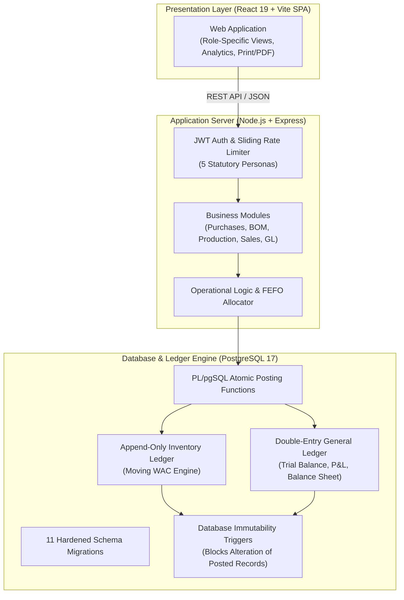

# Order-to-Audit ERP — Enterprise Food Manufacturing System

> **Statutory Food-Manufacturing Enterprise Resource Planning (ERP)**  
> Built with Node.js 22, Express.js 4, PostgreSQL 17, React 19, Vite, Tailwind CSS, and Docker.  
> Developed for **NIT Tiruchirappalli Internship Evaluation Assessment**.

[](file:///backend/tests)
[-blue)](file:///scratch/verify_benchmark_official.js)
[]()

---

## 1. System Overview & Architecture

**Order-to-Audit** is an enterprise manufacturing ERP engineered specifically for commercial food processing. Unlike generic retail ERPs, food manufacturing requires strict batch lineage, statutory mass balance tracking, shelf-life expiry management (FEFO), GST place-of-supply tax segregation, and immutable accounting ledgers.



---

## 2. Quick Start Guide

### Option A: Single-Command Docker Launch (Recommended)

Run the entire ERP application, database, migrations, and benchmark dataset with a single command:

```bash
docker compose up --build -d
```

- **Application URL**: [http://localhost:5000](http://localhost:5000)
- **API Health Check**: [http://localhost:5000/api/v1/health](http://localhost:5000/api/v1/health)
- **Database**: PostgreSQL 17 exposed on `localhost:5432` (`order_to_audit`)

*The container automatically runs schema migrations, seeds benchmark accounts, and synchronizes the General Ledger on first boot.*

---

### Option B: Local Development Setup

#### Prerequisites
- **Node.js**: v20+ or v22+
- **PostgreSQL**: v16+ or v17+ running on `localhost:5432`

#### 1. Configure Environment
```bash
cp .env.example backend/.env
# Verify your PostgreSQL password in backend/.env if different from postgres_secure_password_2026
```

#### 2. Install Dependencies & Setup Database
From the project root:
```bash
# Install dependencies
npm install --prefix backend
npm install --prefix frontend

# Run database setup & seed clean benchmark data
npm run db:setup
```

#### 3. Build & Start Application
```bash
# Build frontend SPA
npm run build

# Start production server (serves API + React SPA on port 5000)
npm start
```
Open **[http://localhost:5000](http://localhost:5000)** in your browser.

---

## 3. Statutory Personas & Demo Credentials

Every persona can log in directly using the standard credentials or using the **1-Click Persona Switcher** on the login page:

| Role Identifier | Role Title | Username | Password | Operational Scope |
| :--- | :--- | :--- | :--- | :--- |
| `owner` | **Managing Director** | `owner_main` | `Password@123` | Full administrative, financial, operational, and managerial control |
| `factory_admin` | **Factory Admin** | `admin_factory` | `Password@123` | Master data, purchase bills, sales approvals, invoicing, and dispatches |
| `production_supervisor` | **Floor Supervisor** | `supervisor_floor` | `Password@123` | Production runs, BOM recipes, material consumption issues, yield recording |
| `salesman` | **Sales Representative** | `salesman_a` | `Password@123` | Mobile-friendly order taking, customer receivables, payment collection |
| `auditor` | **Statutory Auditor** | `auditor_ext` | `Password@123` | Read-only access to General Ledger, Trial Balance, GST registers, and audit logs |

---

## 4. Official Benchmark Scenario Walkthrough & Verification

The official NIT Tiruchirappalli assignment specification defines a 7-step commercial scenario for Murukku food manufacturing. The system verifies this scenario with **100% mathematical precision** (`44 / 44 checks passed`):

```bash
# Run standalone benchmark verification script:
node scratch/verify_benchmark_official.js
```

### Mathematical Proof & Variance Analysis Table

| Benchmark Step | Operational Description | Standard Expected | System Actual | Status | Database Evidence |
| :--- | :--- | :--- | :--- | :---: | :--- |
| **Step 1: Opening Stock** | Raw Flour Opening Balance | 100.00 kg @ ₹42.00 | 100.00 kg @ ₹42.00 | **Verified** | `inventory_ledger` entry `OB-FLOUR-01` |
| | Cooking Oil Opening Balance | 30.00 L @ ₹140.00 | 30.00 L @ ₹140.00 | **Verified** | `inventory_ledger` entry `OB-OIL-01` |
| | Murukku 200g Opening Finished Good | 50.00 pkts @ ₹30.00 | 50.00 pkts @ ₹30.00 | **Verified** | `inventory_ledger` entry `OB-MRK-01` |
| **Step 2: Inbound Purchase** | 60 kg Raw Flour from Trichy Traders @ ₹45 | ₹2,700 taxable + 5% GST | ₹2,700.00 + ₹135.00 | **Verified** | Bill `INV-TRICHY-842` |
| | Moving WAC Update: `(4200 + 2700) / 160` | **₹43.1250/kg** | **₹43.1250/kg** | **Exact** | `item_stock_balances.current_moving_wac` |
| **Step 3: Production Run** | Planned Output (1 standard batch) | 200.00 pkts | 200.00 pkts | **Verified** | Run `PR-20261119-01` |
| | Actual Good Output Yield | 188.00 pkts | 188.00 pkts | **Verified** | Output Batch `BAT-MRK-20261119-01` |
| | **Production Yield Variance** | **-6.00%** | **-6.00%** | **FLAGGED** | `production_runs.yield_variance_pct` |
| | Cooking Oil Consumption | Standard: 10.0 L | Actual: 10.5 L | **FLAGGED** | **+5.00% consumption variance** |
| | Damaged Packaging Pouches | 6 units scrap | 6 units recorded | **Verified** | Recorded in mass balance check |
| | Factory Overheads (Labour + Power/Gas) | ₹1,200 + ₹600 = ₹1,800 | ₹1,800.00 | **Verified** | `production_run_overheads` |
| | Gross Total Production Cost | ₹4,055 materials + ₹1,800 | ₹5,855.00 | **Verified** | `production_run_costing.gross_total` |
| | Unit Production Cost: `5855 / 188` | **₹31.1436/pkt** | **₹31.1436/pkt** | **Exact** | `production_run_costing.cost_per_packet` |
| | Closing Murukku WAC: `(1500 + 5855) / 238` | **₹30.9034/pkt** | **₹30.9034/pkt** | **Exact** | Weighted with 50 opening units |
| **Step 4: Sales to Retailer A** | Sales Order for 150 pkts Murukku @ ₹50 | ₹7,500.00 taxable | ₹7,500.00 | **Verified** | Order `SO-202611-0001` |
| | Statutory GST (Intra-state Tamil Nadu) | CGST ₹187.50, SGST ₹187.50 | CGST ₹187.50, SGST ₹187.50 | **Verified** | Tax Invoice `INV-20261119-001` |
| | Total Invoice Value | ₹7,875.00 | ₹7,875.00 | **Verified** | Total Billed Amount |
| **Step 5: Dispatch & Stock Relief** | Dispatch 150 pkts to Retailer A | Deduct 150 pkts @ ₹30.9034 | 150 pkts relief (COGS ₹4,635.51) | **Verified** | Dispatch `DSP-20261119-001` |
| | Closing Murukku Finished Goods Stock | $238 - 150 = \mathbf{88.00\text{ pkts}}$ | $\mathbf{88.00\text{ pkts}}$ | **Exact** | `item_stock_balances` |
| **Step 6: Payment from Retailer A** | Cheque / Bank Transfer receipt | ₹4,000.00 allocated | ₹4,000.00 | **Verified** | Payment `PAY-2026-0001` |
| | Retailer A Outstanding Balance | ₹7,875 - ₹4,000 = **₹3,875.00** | **₹3,875.00** | **Exact** | `v_invoice_balances.outstanding_balance` |
| **Step 7: Distributor B (Karnataka)**| Salesman attempts order for 120 pkts | Stock available: 88 pkts | **Shortage of 32 pkts flagged** | **Verified** | Stock warning on UI & API |
| | Place of Supply Tax Calculation | State Code 29 (Inter-state) | **IGST 5% applied (₹0 CGST/SGST)** | **Verified** | Interstate place of supply rule |
| **Accounting Balance** | Double-Entry Equilibrium | Debits == Credits | **₹25,200.51 = ₹25,200.51 ($\Delta = 0.00$)** | **Balanced** | `v_trial_balance` |

---

## 5. Testing & Quality Verification Suite

The repository includes **214 automated integration tests** validating security, immutability, inventory posting, and financial math:

```bash
# Run full sequential test suite (from project root)
npm test
```

### Test Suite Inventory

| Test Suite File | Subtests | Description & Coverage | Status |
| :--- | :---: | :--- | :---: |
| `auth.test.js` | 21 | JWT issue/verify, RBAC permissions, password change, brute-force rate limiter | **PASS** |
| `master-data.test.js` | 17 | Items, Units of Measure, BOM creation, party GSTIN validation | **PASS** |
| `bom.test.js` | 20 | Multi-level BOM hierarchy, circular reference prevention, version locking | **PASS** |
| `purchases-inventory.test.js` | 18 | Inbound purchase bills, Moving WAC recalculation, stock receipt | **PASS** |
| `production-costing.test.js` | 16 | Batch scheduling, material issue at WAC, scrap recording, cost rollup | **PASS** |
| `production-hardening.test.js` | 12 | Database immutability triggers on completed runs, mass balance check | **PASS** |
| `sales-dispatch-invoicing.test.js` | 28 | Sales orders, credit checks, statutory GST invoicing, dispatch COGS | **PASS** |
| `payments-receivables.test.js` | 22 | Payment allocations, over-allocation prevention, atomic reversals | **PASS** |
| `financial-accounting.test.js` | 26 | Chart of Accounts, manual journal entries, GL sync, Trial Balance, P&L | **PASS** |
| `advanced-erp-operations.test.js` | 22 | Supplier payables, multi-warehouse transfers, FEFO batches, adjustments | **PASS** |
| `health.test.js` | 12 | API health check, database ping, environment configurations | **PASS** |
| **Total Test Baseline** | **214** | **100% Pass Rate across all 11 suites (0 failures)** | **GREEN** |

---

## 6. Security & Production Hardening

- **Database-Level Immutability**: Critical financial tables (`inventory_ledger`, `invoices`, `payments`, `journal_entries`) are guarded by PL/pgSQL triggers (`BEFORE UPDATE OR DELETE`). Even direct SQL modification by a database operator is blocked once a record is posted.
- **Sliding-Window Rate Limiter**: Configured with a sliding window of 5 failed attempts per IP. Rate limiter automatically clears on successful login, permitting rapid switching between benchmark accounts while repelling brute-force intrusions.
- **Strict Role-Based Access Control**: Every endpoint is protected with `authenticate` and `authorizeRoles(...)` middleware, ensuring salesmen cannot touch production/accounting and floor supervisors cannot generate tax invoices.
- **Statutory Production Mode**: Demo auto-login (`POST /api/v1/auth/demo-login`) is gated by environment configuration (`ENABLE_DEMO_LOGIN=true`), rejecting unauthorized demo sessions in production environments.

---

## 7. Known Limitations & Architectural Trade-offs

1. **Monolithic PostgreSQL Deployment**:
   - *Design Choice*: A single PostgreSQL instance handles operational data and the general ledger.
   - *Trade-off*: Simplifies ACID transactions and double-entry consistency; for high-scale enterprise deployments (>100,000 transactions/day), event sourcing or asynchronous CQRS streaming to an analytical warehouse would be preferred.
2. **Synchronous Moving WAC Computation**:
   - *Design Choice*: Unit rates are recalculated in stored functions inside the database transaction.
   - *Trade-off*: Guarantees zero latency between receipt and valuation, but creates brief row-level lock contention on `item_stock_balances` during concurrent high-volume receipts of the same SKU.
3. **Single Active Currency**:
   - *Design Choice*: The platform uses Indian Rupee (INR - ₹) with standard 2-decimal and 4-decimal precision. Multi-currency foreign exchange revaluation is not implemented.
4. **Offline Mobile Synchronization**:
   - *Design Choice*: The salesman interface is mobile-optimized via responsive web UI. An offline PWA with background sync was deferred in favor of direct server-validated credit limit and stock checking.

---

## 8. Technical Documentation & Design Notes

For deep-dive architectural documentation, mathematical formulas, and the 15-question Technical Interview Defense Guide, consult:
- **[DESIGN_NOTE.md](file:///DESIGN_NOTE.md)**: 2-page concise architectural specification, ERD, and interview prep.
- **[database/setup.sql](file:///database/setup.sql)**: Master SQL bootstrap script.
- **[scratch/verify_benchmark_official.js](file:///scratch/verify_benchmark_official.js)**: Standalone 44-point benchmark validation suite.
